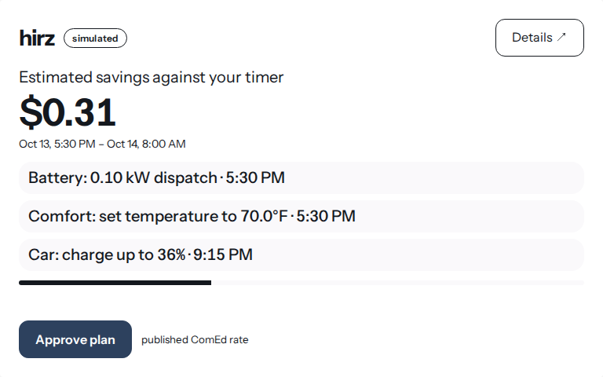
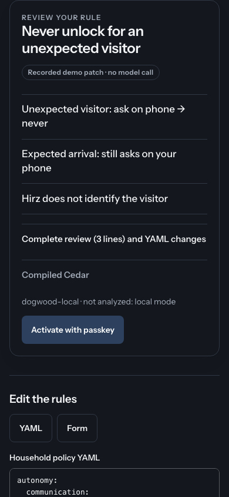
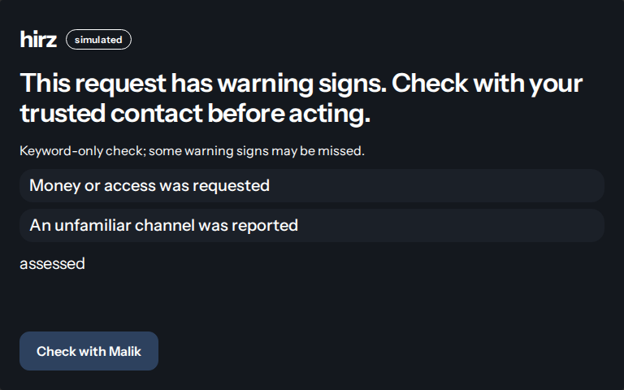
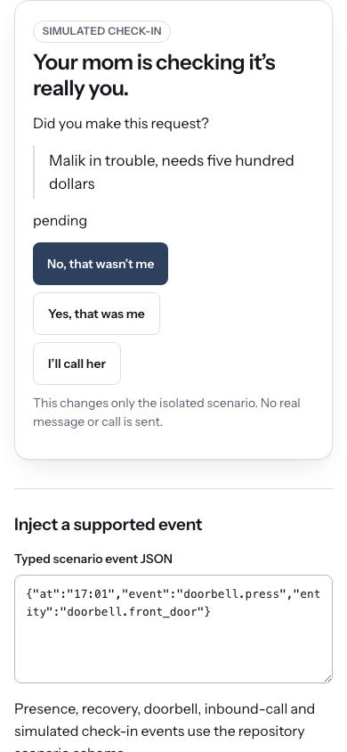
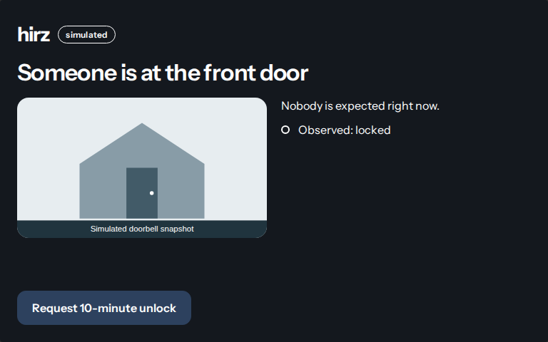
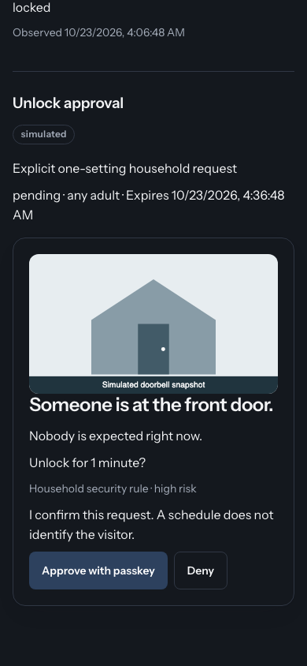
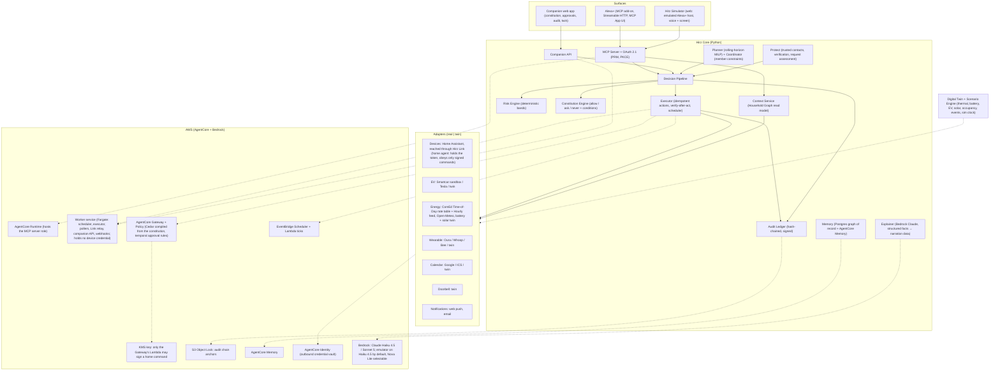

# Hirz

**House rules for the AI in your home, and your parents'.**

Hirz lets your family decide what Alexa may do on its own, what it must ask about, and what it may never do. It holds a shared model of the people, devices, schedules, energy, and trust relationships in a home, plans against household goals instead of one-off commands, and acts only inside boundaries the household wrote down. The name for that in the architecture docs is *bounded autonomy*.

> Built for the **Build, Ship, Shape: Amazon Developer Hackathon 2026**: Alexa+ track and both mini-challenges, AWS Builder and Open Source. Designed as a startup, not a weekend project: see [`ROADMAP.md`](./ROADMAP.md) for the hackathon cut line and what comes after it.

**Submission status (2026-10-23).** The entry is the working Hirz Simulator: a
real MCP server (2025-11-25, Streamable HTTP, OAuth 2.1 PKCE, MCP Apps cards)
driven by an emulated Alexa+ host in the browser, with explicitly labeled
simulated devices, deterministic local policy checks, passkey approvals in the
companion app and signed local audits. Demo video: VIDEO_URL_PENDING. Judges run
it with no credentials from the [quickstart](#quickstart) and the
[judge run instructions](#judge-run-instructions). The signed-home architecture
described below is the design: AgentCore Policy enforcement, Hirz Link, audit
anchors, the hosted demo, boundary passkeys, real push and email delivery, and
the physical plug are **deferred beyond this submission**, each with its gate
still open in the [roadmap](./ROADMAP.md) and its row unpromoted in the
[threat model](./THREAT_MODEL.md). Hallway tests with outside participants
(roadmap item 40a) were not run before the deadline, so no usability result is
claimed.

---

## Who it's for

The family's household manager: the adult who set up the smart home at their own place and at their parents' place, and who carries the worry for both.

- People reported losing **$3.5 billion to imposter scams in 2025**, nearly one in three fraud reports, and nearly three times the 2020 figure ([FTC, 2026-06-15](https://www.ftc.gov/news-events/news/press-releases/2026/06/ftc-data-show-people-reported-losing-3-point-5-billion-imposter-scams-2025)).
- Fraud losses reported by adults 60 and over rose about fourfold, from about $600 million in 2020 to **$2.4 billion in 2024**, driven largely by losses over $100,000, often to investment scams, romance scams, or impersonations ([FTC, *Protecting Older Consumers 2024–2025*](https://www.ftc.gov/news-events/news/press-releases/2025/12/ftc-issues-annual-report-congress-agencys-actions-protect-older-adults)).
- **63 million Americans**, about one in four adults, are family caregivers ([AARP and the National Alliance for Caregiving, *Caregiving in the U.S. 2025*](https://www.aarp.org/press/releases/2025-07-24-new-report-reveals-crisis-point-for-americas-63-million-family-caregivers.html)).

An assistant that can unlock doors and change the thermostat while someone sleeps, in a home you are responsible for but do not live in, needs rules you can read and proof they held. Hirz is **rules, not care**: it does not do medication or health monitoring. It gives that person autonomy inside a boundary at home, and protection at their parents'. It also does not stop scam calls. It gives Mom one simple thing to do: *ask first*.

## What it does

5:05 PM, at Mom's.

> **Mom:** Alexa, Malik just called from a strange number. He says he's in trouble and needs five hundred dollars. Is it really him?
>
> **Alexa (Hirz):** This looks like a family-impersonation scam. Don't send anything yet. I'm checking with Malik on his own phone. Ask me again in a minute.

Malik's phone buzzes: *"Your mom is checking it's really you. Did you just call her from another number asking for $500?"* He taps **No, that wasn't me.** The card on Mom's Echo Show moves from *checking with Malik* to the answer. Alexa cannot speak unprompted, so Mom asks.

> **Mom:** Alexa, is it him?
>
> **Alexa (Hirz):** Malik says that wasn't him. Don't send anything.

Hirz never used anything the caller said as a fact, and it never claimed to know the caller's number: it cannot see the call, and Mom did not read the number out. It asked Malik, about this specific request, through a channel the family verified in advance.

5:31 PM, at Malik's. He is just home, and rattled.

> **Malik:** Alexa, from now on, never unlock the door for someone we're not expecting.
>
> **Alexa (Hirz):** I've written that as a rule and sent it to your phone. It won't take effect until you approve it there.

On his phone: one English sentence, what changes in concrete situations (*Unexpected visitor: ask on phone → never. Expected arrival: still asks on your phone. Hirz does not identify the visitor.*), the compiled policy underneath. Those lines are computed by running the old and the new rules over a fixed set of situations; no model writes them. He activates it with his passkey. Anyone in the room can propose a rule. Only a person on their own phone can activate one.

> **Malik:** What's going on tonight?
>
> **Alexa (Hirz):** You're in the peak window until 7. I'll run the house off the battery, warm the living room for your mom, and hold the car until after 9.

The screen shows the plan as a card: what it saves tonight, three rows, one Approve button. He changes it by voice ("don't charge the car past 50, I'm not driving tomorrow"). Alexa confirms the constraint at once ("Got it, the car stops at 50. I'm updating the plan."), the card refreshes when the new plan lands a moment later, and only then does he say "do it". Hirz never lets him approve a plan that is still being recomputed.

At 6:40 the doorbell rings and nobody is expected. "Let them in."

> **Alexa (Hirz):** You added a rule tonight: I never unlock for someone who isn't expected.

At 7:04 it rings again. A vehicle pulled in at 6:58, and Mom is expected at 7:00. "That's my mom, let her in."

> **Alexa (Hirz):** Unlocking the door needs your approval on your phone. I've sent it.

The phone does not say "unlock for Mom". It says *"Someone is at the front door. Mom is expected now. Unlock for 10 minutes?"* A schedule is context, not identity: Malik is the one who confirms who is there.

Same lock, two outcomes. *Never*, because the family said so an hour ago. *Ask*, on a phone, never by voice, because an Echo is a shared device and Alexa does not tell add-ons who is speaking.

Every one of those sentences is backed by a structured record: what Hirz did, why, under which rule of the household constitution, at what risk band, and who approved it. Every number Hirz speaks comes from a cited scenario run. The demo household is on ComEd's published Time-of-Day rate, where the all-in peak price is several times the overnight price; a historical counterpart is also run on ComEd's archived Hourly feed, and the backtest table below shows both. Nothing here is typed by hand.

The headline saving is measured against what a careful household already does: the car on a timer after 9 PM, the battery on its default self-consumption mode, the dishwasher on delay start. "Do everything now" and a simple cheapest-slots strategy are shown beside it. Every strategy delivers the same comfort, the same energy into the car, and ends with the battery at its opening state of charge. On Hourly Pricing the backtest decides with the prices that were knowable at the time and is billed at the prices that actually happened. It also runs a home with a car and no solar or battery, and it reports the days on which Hirz adds little.

The retained simulation covers **2025-09-01 17:30 through 2026-09-01 17:30,
America/Chicago**, carrying every strategy's physical state across all 365 days.
Both profiles apply the pinned 2026 tariff counterfactually. Hourly costs are
feed-based supply-plus-distribution estimates, not reconciled bills; missing
quotes leave **194/365 eligible days**. The table includes battery wear at
$0.01 per internal-throughput kWh and preserves negative savings. Annualized
values extrapolate the eligible-day mean × 365; missing data may bias them.

| Rate | Household | Net saving vs timer: median (p10–p90) | vs immediate: median | vs greedy: median | Annualized extrapolation | Eligible/total |
|---|---|---|---|---|---|---|
| Time-of-Day | solar + battery + EV | $-0.24 ($-1.29–$0.52) | $1.32 | $-0.24 | $-124.47 | 365/365 |
| Time-of-Day | EV only | $0.25 ($-0.60–$0.94) | $2.64 | $0.25 | $66.68 | 365/365 |
| Time-of-Day | solar + battery, no EV | $-0.16 ($-1.36–$0.51) | $-0.16 | $-0.16 | $-103.11 | 365/365 |
| Hourly | solar + battery + EV | $0.21 ($-0.52–$0.73) | $0.48 | $0.14 | $60.02 | 194/365 |
| Hourly | EV only | $0.20 ($-0.56–$0.67) | $0.38 | $0.13 | $38.19 | 194/365 |
| Hourly | solar + battery, no EV | $0.14 ($-0.57–$0.50) | $0.14 | $0.14 | $24.82 | 194/365 |

Generated from [retained results](./scripts/backtest-data/results.json), including
wear sensitivity, observed electricity and wear costs, exclusions, losses,
exported energy, worst timer day, negative-price charging durations and coverage.
See [verification](./docs/verification-log.md#full-offline-reproduction-and-completion--2026-09-21)
and [reproduction procedures](./docs/development.md#item-17-planner-and-backtest).

## Screens

Rendered from the actual application at Amazon's 768×480 card canvas and at phone width. Every device is a labeled twin.

| Echo Show | Phone |
|---|---|
|  |  |
|  |  |
|  |  |

The simulator itself, with the Echo Show as the hero and the tool-call transcript beside it: [`docs/img/simulator.png`](./docs/img/simulator.png). The scorecard's fullscreen view: [`docs/img/card-scorecard.png`](./docs/img/card-scorecard.png).

## Why existing agents fall short

Alexa+ can now call third-party tools over MCP, orchestrate multi-turn conversations, and render interactive UI. Household agents built on it already follow a common pattern: an allowlist of actions, a human-approval step for the risky ones, and an audit trail. That pattern is necessary and Hirz has it. It is not sufficient, for three reasons:

1. **The boundary is the developer's, not the household's.** An allowlist is written in code by whoever built the agent. A family needs to *write* the answer to "how much authority do you have?" themselves, change it, and see proof that it was enforced somewhere the agent's own code cannot get around.
2. **Trust comes from the caller.** The same channel that takes "turn off the lights" also takes "it's me, I'm in trouble, send money". An assistant with no record of who Malik is and how to reach him can only take the caller's word for it.
3. **One user, one command at a time.** Preferences, routines, people, assets, and constraints live in ten apps and nobody's head. Energy optimizers exist (EMHASS schedules solar, a battery, and deferrable loads for Home Assistant, and Home Assistant lets a household choose which devices an assistant can see). What they do not carry is the household: whose constraint moved the dishwasher, which written rule let the battery discharge, who approved the unlock, and proof that the limit held. Hirz's claim is that combination: household-authored permissions governing coordinated automation, with authenticated exceptions and evidence of enforcement.

## What Hirz adds

Approval gates, an audit ledger, and a simulated Alexa+ host are the baseline for a household agent, and Hirz has all three. The four things below are what Hirz adds on top of that baseline.

| | What it is | Why it matters |
|---|---|---|
| **A boundary the household writes, that the home itself enforces** | A Household Constitution, proposed by voice or written as a form, as YAML, or in plain English, and always activated by a person on their own phone. It states per action class and per member what Hirz may do on its own, what it must ask about, and what it may never do. Every version compiles to a Cedar/Dogwood policy set that AgentCore Policy enforces at the AWS tool boundary, including a temporal "approval must precede action" rule. Only a permit gets a command signed, and the home-side agent, Hirz Link, obeys only signed commands. | The boundary belongs to the family, not the developer. Hirz's own processes hold no credential that can act on a device; only commands the policy engine authorized are signed, and the home obeys only signed commands, once each, addressed to that home. This covers a bug or a bypass path in Hirz's own code. It does not yet cover a fully compromised worker, which could still tell the boundary an approval happened; closing that for security actions (the passkey itself verified at the boundary) is `ROADMAP.md` item 38d, and `THREAT_MODEL.md` says No until it is built. **Status:** in-process enforcement, the Cedar compiler, native Dogwood agreement, passkey activation and the signed audit are verified locally; enforcement at the AWS boundary (item 37) and Hirz Link (item 38a) are deferred and not claimed. |
| **Verification from the household's own records** | Trusted contacts have channels verified out of band at setup. A request is checked against those records and confirmed through the subject's own app or verified number, never through anything the caller supplied. A recent scam call plus an unexpected visitor at the door raises a warning. Hirz has no way to move money, by design. | "Is this really Malik?" is answered by the graph, not by the person asking. |
| **A real planner over real prices** | A rolling-horizon MILP schedules the EV, the home battery, HVAC, and appliances against the household's real rate plan (all-in, supply plus delivery) and live weather, per-occupant comfort bands, and member constraints, and reports savings against a timer schedule a careful household would already use, with "do everything now" and a cheapest-slots strategy beside it, all held to the same comfort and delivered energy. A physics twin supplies every device that is not real, labeled as simulated. | The savings on the scorecard are computed, not typed, and the binding constraints and rejected alternatives are outputs of the model rather than a story about it. |
| **Multi-member coordination with provenance** | Each constraint and preference keeps the linked account it arrived on, the surface, and the time: "Dad, 22:40: kitchen in use until 23:00" survives into the plan, the explanation, and the audit row. Alexa does not say who spoke, so provenance is the account, never the voice; a name someone merely claims is recorded as claimed. Conflicts between members are returned as data with the people involved, never silently resolved. | A household is not one user. The plan can say whose request moved the dishwasher, and why. |

Underneath all four: a deterministic risk engine whose bands set floors the constitution can tighten but never loosen, and a pipeline in which every action carries what, why, which rule, and what was rejected, as data that Alexa narrates. Those are the mechanisms that make the four hold; they are not the claim.

In local mode there is no outside boundary: the second policy evaluator runs in the same container and is labeled as exactly that. "Enforced outside Hirz" is claimed for the AWS deployment only.

**What the rules cover.** Hirz governs the actions Hirz takes. A lock that is also linked to Alexa directly, exposed to an assistant by Home Assistant, or opened with the vendor's app or a key has a path that does not pass through Hirz, and Hirz cannot refuse what it never sees. The deployment rule is that a device Hirz governs is not exposed to Alexa by another route; the Household page shows each device as *managed through Hirz* or *not managed*; and when a governed device changes state without a command from Hirz, that is recorded as *changed outside Hirz* and, for locks and cameras, the owner is told. A manual thermostat change is respected for a while rather than overwritten. `THREAT_MODEL.md` has the row.

## Architecture


*Observe → Understand → Plan → Evaluate Risk → Check Authority → Act → Verify → Remember. Every action Hirz takes passes through that loop, and every step of it is recorded.*

Every box is a module described in [`ARCHITECTURE.md`](./ARCHITECTURE.md). Surfaces talk to Hirz Core only through MCP tools or the companion API; Core talks to the world only through adapters, each of which has a real implementation and a **digital-twin** implementation behind the same interface.



**The decision pipeline, in order.** A proposed action is resolved by one deterministic, ordered pipeline (full detail in `ARCHITECTURE.md` §3):

```
1. Identity + role resolution      → unknown requester → least authority
2. Constitution NEVER              → DENY (terminal)
3. Risk floor                      → CRITICAL → DENY or VERIFY (terminal)
4. Constitution mode + conditions  → auto | ask | never
5. Risk band escalation            → HIGH forces ASK even where the constitution says auto
6. Budgets and rate limits         → daily $ limit, action counts → ASK or DENY
7. Boundary enforcement (Cedar)    → AgentCore Policy must agree; disagreement fails closed
8. → EXECUTE | ASK | DENY | VERIFY    (EXECUTE on a home device = a command the boundary signed, verified in the home)
```

## Tech stack

| Layer | Choice | Why |
|---|---|---|
| Core | Python 3.12, FastAPI, official `mcp` SDK (FastMCP), async throughout | First-party MCP SDK; same stack as the author's prior MCP work; AgentCore Runtime's MCP contract is Python-first |
| Planner | `scipy.optimize.milp` (HiGHS) rolling-horizon scheduler | Deterministic, explainable, one dependency; no LLM in the optimization loop ([ADR-005](./docs/adr/ADR-005-deterministic-planner.md)) |
| Policy | YAML constitution + Pydantic schema + a non-Turing-complete condition grammar, compiled to Cedar | Git-diffable, validated at load, analyzable; enforced in-process and at the AWS tool boundary ([ADR-003](./docs/adr/ADR-003-constitution-yaml-to-cedar.md)) |
| Risk | Fixed action-class table + dynamic factors, **no ML** | A household decision the family can't explain is one they can't trust ([ADR-004](./docs/adr/ADR-004-no-ml-risk-scoring.md)) |
| Storage | PostgreSQL 16 (household graph, constitution versions, plans, approvals, audit chain) + AgentCore Memory (conversational, preference extraction) | Relational integrity for a hash chain; graph as tables + JSONB ([ADR-002](./docs/adr/ADR-002-postgres-over-dynamodb.md)) |
| Surfaces | React + TypeScript: MCP App cards (`@modelcontextprotocol/ext-apps`, plain CSS carrying Amazon's design tokens), companion app and simulator (Tailwind + shadcn/ui) | The MCP Apps SDK and the Alexa tooling are TypeScript ([ADR-001](./docs/adr/ADR-001-python-core-typescript-surfaces.md)); the cards follow Amazon's add-on design guide verbatim ([`docs/design.md`](./docs/design.md)) |
| Home agent | Hirz Link: a small Python process beside Home Assistant, outbound-only, executes only KMS-signed commands | The Home Assistant token never leaves the house, no tunnel, and a bypass in Hirz's own processes has nothing to act with ([ADR-009](./docs/adr/ADR-009-signed-commands-home-agent.md)) |
| Open source | [addon-check](https://github.com/BashaarJavaid/addon-check): an independent MCP checker; simulator host harness remains item 29a | Explicit cases produce scoped protocol, schema, authentication and speech evidence without claiming Amazon certification; Hirz CI runs the checker ([ADR-016](./docs/adr/ADR-016-add-on-conformance-checker.md)) |
| Alexa+ | MCP 2025-11-25, Streamable HTTP, OAuth 2.1 + PKCE S256, Protected Resource Metadata, MCP Apps for visuals | The add-on contract, verbatim ([ADR-007](./docs/adr/ADR-007-alexa-surface-strategy.md)) |
| AWS | AgentCore Runtime, Gateway, Policy, Memory, Identity; Bedrock (Claude Haiku 4.5 / Sonnet 5; the emulator runs Haiku 4.5 by default with Nova Lite selectable); EventBridge Scheduler + Lambda; KMS (command signing); S3 Object Lock (audit anchors); CDK (TypeScript) | AWS runs Hirz's agentic state and enforcement, not just its hosting ([ADR-008](./docs/adr/ADR-008-agentcore-topology.md)) |
| Twin | Physics-lite models with a simulated clock and a YAML scenario DSL | Everything is demonstrable end to end with no hardware, and every scenario is an integration test ([ADR-006](./docs/adr/ADR-006-twin-first-adapters.md)) |
| Ops | Docker Compose (Postgres, Home Assistant demo, Hirz), OpenTelemetry → CloudWatch via AgentCore Observability, GitHub Actions (ruff / mypy strict / pytest 80% gate / tsc / vitest / playwright) | |

## Repository layout

```
Hirz/
├── README.md, ARCHITECTURE.md, THREAT_MODEL.md, ROADMAP.md, SECURITY.md, CHANGELOG.md
├── CLAUDE.md, AGENTS.md            # instruction files for coding agents (kept at parity)
├── docs/
│   ├── adr/                        # one file per consequential decision
│   ├── constitution.md             # the Household Constitution spec
│   ├── tool-catalog.md             # every MCP tool: name, schema, output, voice fallback
│   ├── twin-and-scenarios.md       # digital twin models and the scenario DSL
│   ├── design.md                   # Amazon's design tokens, per-card specs, the seven hand-designed screens
│   ├── demo-script.md              # the 3-minute video, beat by beat
│   └── submission.md               # hackathon requirements checklist
├── hirz/                          # Python core package
│   ├── graph/                      # household graph models, repository, versioning
│   ├── constitution/               # schema, loader, condition grammar, Cedar compiler, evaluator
│   ├── risk/                       # action classes, factors, bands
│   ├── pipeline/                   # the decision pipeline and the canonical Decision
│   ├── planner/                    # MILP scheduler, coordinator, plan diff
│   ├── executor/                   # action runtime, scheduler, verify-after-act
│   ├── protect/                    # trusted contacts, verification, request assessment
│   ├── contacts/                   # trusted contacts, enrollment, real check-ins
│   ├── memory/                     # private session memory, consented preferences
│   ├── explainer/                  # Bedrock-backed explainer (structured in, structured out)
│   ├── audit/                      # hash chain, signing, export, verifier
│   ├── adapters/                   # one package per domain; each has real/ and twin/
│   ├── twin/                       # physics models, sim clock, scenario engine
│   ├── link/                       # Hirz Link: the home agent that obeys only signed commands (Phase 7, not yet built)
│   ├── mcp/                        # MCP server, tools, OAuth PRM, MCP App resources
│   ├── api/                        # companion API (FastAPI)
│   ├── companion/                  # companion API, passkeys, push, policy activation
│   ├── host/                       # scripted host, simulator, selection
│   └── cli.py                      # hirz CLI: decide, plan, scenario, verify-audit, doctor
├── apps/
│   ├── mcp-app/                    # React MCP App bundle (plan card, approval card, verification card, scorecard)
│   └── web/                        # one React app: companion pages + the Alexa+ simulator route (emulator agent, voice, device modes)
├── infra/cdk/                      # AWS CDK (TypeScript): AgentCore, Cognito, Bedrock access, scheduler, RDS
├── scenarios/                      # YAML scenarios (the parents' scam check, the demo evening, test fixtures)
├── constitutions/                  # quinn-home (Malik's), quinn-parents (Mom and Dad's), examples
├── tariffs/                        # published rate tables with source URLs (ComEd Time-of-Day)
├── compose.dev.yml, compose.demo.yml, compose.link.yml
├── alembic/                        # Postgres migrations
├── scripts/
└── tests/{unit,integration,adversarial,scenarios,ux,latency}
```

## Quickstart

Use Python 3.12, Node 24, uv, pnpm and a running Docker Desktop:

```bash
git clone https://github.com/BashaarJavaid/Hirz && cd Hirz
uv sync --locked
pnpm install --frozen-lockfile
pnpm --filter mcp-app build && pnpm --filter web build
uv run --locked python scripts/demo.py init --origin http://localhost:8002
uv run --locked python scripts/demo.py run
open http://localhost:8002/simulator
```

Toolchain installation, development services, credential recovery and CI details
are in [development procedures](./docs/development.md).

Keep the launcher running. Enroll from the private invitations file it names,
activate the seed rules with the laptop's passkey, then explicitly approve Echo
linking in the simulator. This isolated recording stack uses simulated devices
and scripted responses; no AWS account is required. Each fresh run requires fresh
enrollment and linking.

A phone needs the Tailscale HTTPS origin instead of localhost; see
[recording setup and shutdown](./docs/development.md#item-30-recording-stack).
There is no hosted demo; item 38c is deferred.

### Judge run instructions

1. With the launcher running and enrollment done, open `http://localhost:8002/simulator`. The banner names the host in use and says the devices are simulated.
2. Choose **Mom's Echo** and type or say: *Malik just called from a strange number. He says he's in trouble and needs five hundred dollars. Is it really him?* Then open the companion app's Check-ins page as Malik and answer **No, that wasn't me**. Back on Mom's Echo: *Alexa, is it him?*
3. Choose **Malik's Echo**. The demo evening is paused at 17:30; press **Play 1×** or **Next event**. Say: *From now on, never unlock the door for someone we're not expecting.* Open the companion app's Constitution page, read the three situation lines, and activate the rule with your passkey.
4. *What's going on tonight?* shows the plan card. *Don't charge the car past 50, I'm not driving tomorrow* revises it. *Do it* approves it.
5. Switch Display to **Echo Dot** for the voice-only version of any of the above.
6. When the 18:40 doorbell fires, *Let them in* is refused under the rule you activated. At 19:04, the expected arrival asks for approval on the phone, never by voice; approve it on the Approvals page with your passkey and watch the relock.
7. Try to break it: say *pause Hirz*; propose a rule of your own and read its situation lines before activating.
8. Proof: the Audit page lists every decision; `uv run hirz verify-audit --household <household-uuid>` checks the signed chain, and `uv run hirz scenario run scenarios/demo-evening.yaml --headless --assert` reproduces the evening's numbers offline.

Starting a real check-in requires `uv run --locked python scripts/init_contacts.py`
first; without the contact key the worker prints a status line, email check-ins
stay disabled and app check-ins still time out
([trusted-contact setup](./docs/development.md#trusted-contact-acceptance-item-31)).

## Documentation

- [`ARCHITECTURE.md`](./ARCHITECTURE.md) — layers, the decision pipeline, canonical objects, every component in depth, data model, latency budget, failure modes, hardening, observability, testing, CI/CD, deployment
- [`THREAT_MODEL.md`](./THREAT_MODEL.md) — what Hirz protects against, what it doesn't, and the assumptions underneath
- [`docs/constitution.md`](./docs/constitution.md) — the Household Constitution: schema, modes, conditions, compilation to Cedar, examples
- [`docs/tool-catalog.md`](./docs/tool-catalog.md) — the MCP tool surface Alexa+ sees
- [`docs/twin-and-scenarios.md`](./docs/twin-and-scenarios.md) — the digital twin and scenario DSL
- [`docs/design.md`](./docs/design.md) — the visual design spec: Amazon's tokens, display modes, per-card specs
- [`docs/demo-script.md`](./docs/demo-script.md) — the video storyboard
- [`docs/submission.md`](./docs/submission.md) — hackathon checklist and the product-feedback / friction-log plan
- [`docs/adr/`](./docs/adr/) — decisions and rejected alternatives
- [`ROADMAP.md`](./ROADMAP.md) — build order as a living checklist, with the hackathon cut line
- [`docs/verification-log.md`](./docs/verification-log.md) — the evidence behind every completed roadmap item: commands, numbers, environment, CI runs
- [`SECURITY.md`](./SECURITY.md) — disclosure policy

## How this is built

Hirz is built by one engineer working with AI coding assistants. The design decisions are the human's: the thesis, the four things Hirz adds, the decision pipeline and its precedence, the fail-closed posture, the choice to keep the risk engine free of ML and the constitution non-Turing-complete, the twin-first adapter strategy, and every rejected alternative in `docs/adr/`. The assistants implement downstream of those decisions under the standing rules in [`CLAUDE.md`](./CLAUDE.md): surface assumptions, ask before deciding, no speculative complexity, verify every feature by running it.

Nothing in this README is asserted on a model's say-so. Where something is simulated it is labeled as a twin in the UI and in the docs. Where something is unproven or unprotected, `THREAT_MODEL.md` says so.

## License

Apache-2.0. See [`LICENSE`](./LICENSE).
